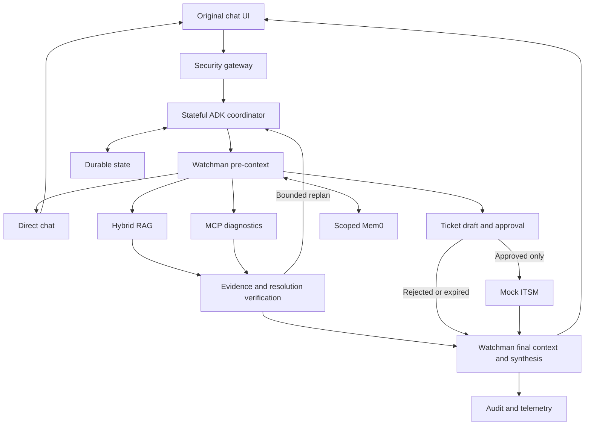

> **Status note:** this is the long-form spec. For what is built, scope cuts for the hackathon, and next steps, read `NEXT_STEPS.md` first.

# OpsGate V3.1 — Secure, Self-Optimizing Agentic IT Service Desk
**Use Case 05 | Implementation master plan | Normative handoff to coding agents**

## 0. Authoritative handoff
This single Markdown file consolidates the V3 plan and the latest UI preservation decision. Backend enhancements remain mandatory. In conflicts, the original chat HTML governs visual appearance, this specification governs backend behavior, and organizer requirements govern platform compatibility. Do not silently resolve conflicts; document blockers and ask for approval.

## 1. Mission and non-negotiable scope
Build a runnable, production-oriented hackathon prototype for L1 IT support, retaining the original four paths, isolated Streamlit UI, Microsoft Foundry + organizer ADK, GPT-4.1-mini, Watchman, three-tier Mem0, NDMC and general L1 MCP tools, citations and human-approved mock ITSM. All infrastructure and civic-service responses are synthetic; no real system changes, real ticket creation, real employee data or live NDMC status claims. Do not silently substitute a different orchestration framework. Do not claim production certification or benchmark results before testing.

Source baseline: supplied OpsGate architecture image and three Gemini MHTML exports, including the latest visual breakdown canvas. V3 changes are the agreed review recommendations. The original standalone master Markdown and runnable project ZIP were not supplied separately. The original canvas is a reference for visual design, not a verified working application. This plan supersedes conflicting implementation details in those exports, particularly unsafe VPN guidance and false retrieval confidence.

## 2. Architecture and visual contract


The architecture viewer is a separate optional engineering surface, not the employee chat UI. The component table below defines the numbered architecture.

| ID | Component | Responsibility |
|---|---|---|
|01–04|Entry, UI, gateway, refusal|Authenticated session, input and file checks, redacted refusal|
|05–07|Primary agent, Watchman pre-context, router|Durable state, select relevant memory and route|
|08|Path 1|Static greeting/scope/clarification; bypass retrieval and synthesis when deterministic|
|09|Path 2|Hybrid retrieval, pagination, evidence assessment|
|10|Path 3|Deferred MCP, NDMC and IT diagnostics|
|11–13|Path 4|Draft, approval, mock ITSM creation|
|14|Verification|Evidence adequacy, user outcome, bounded replan|
|15–16|Watchman final and synthesis|Budgeted grounded answer, citations|
|17–18|Reply and end/wait|Trace, telemetry, user confirmation or terminal status|
|19–21|Memory, durable state, KB/evaluation|Scoped retrieval, transactions, audit and versioned evidence|
|22–23|Reject/expire and receipt|No creation on rejection; receipt only after successful mock creation|

### Agent roles
Keep the primary L1 agent (router/coordinator) and synthesis LLM role as in the source. Use deterministic services for security, retrieval, policy, SLA, state and approval; no unnecessary additional autonomous agents. Compactor may use GPT-4.1-nano if available, otherwise deterministic pruning. Do not expose hidden reasoning; trace only decisions, evidence and tool events.

## 3. Stack and deployment
- Python 3.13 is the source manifest target; verify organizer SDK compatibility before pinning. If incompatible, document the approved supported Python version. Pin dependencies and commit lockfile.
- Streamlit `app.py` on 8501; FastAPI transport on 8000; organizer Foundry/ADK runtime on 8088 where supported. The API is the single state owner; never instantiate an independent engine in Streamlit. The 8088 adapter must be real, not a renamed mock.
- GPT-4.1-mini synthesis/router, configurable compactor and embedding deployment; BM25 + FAISS; Mem0; SQLite WAL for demo, PostgreSQL migration path; Pydantic strict models; MCP SDK; Tenacity; OpenTelemetry; pytest; Docker Compose.
- Verify actual Foundry and ADK SDK, auth, deployment and `azure.yaml` schema against organizer documentation before implementation. Source manifest `host: azure.ai.agent`, `runtime: python_3_13` is an unverified baseline, not a guaranteed valid deployment. Provide explicit `DEMO_MODE=true` fixture adapter and fail clearly if live mode lacks credentials. Never present fixtures as live Foundry calls.
- `.env.example`: OPENAI_MODEL, COMPACTOR_MODEL, EMBEDDING_MODEL, FOUNDRY_HOST, API_HOST, MAX_INPUT_CHARS=1500, WATCHMAN_SOFT_TOKENS=1800, WATCHMAN_HARD_TOKENS=2500, MAX_REPLANS=2, MAX_TOOL_CALLS=5, APPROVAL_TTL_SECONDS=900, DEMO_MODE=true. Secrets from environment/secret manager only; never commit keys. Thresholds configurable and calibrated.

## 4. Repository contract
```text
opsgate/
  README.md  azure.yaml  pyproject.toml  lockfile  .env.example
  Dockerfile  compose.yaml  app.py  main.py
  frontend/  # preserved HTML styling, Streamlit component bridge
  opsgate/
    api/{routes,auth,schemas}.py
    agents/{coordinator,foundry_adapter,synthesis}.py
    security/{guardrails,authorization,uploads,redaction}.py
    orchestration/{state_machine,policy,checkpoint}.py
    rag/{ingest,bm25,vector,rrf,verify}.py
    watchman/{budget,compact,prefix,usage}.py
    memory/{mem0_adapter,scopes,retention}.py
    tools/{registry,ndmc_server,l1_server,contracts}.py
    itsm/{drafts,approval,mock,priority,outbox}.py
    storage/{models,migrations,repository}.py
    telemetry/{events,metrics,tracing}.py
  data/{kb_articles,users,dummy_queries,service_catalog,sla_matrix}.json
  scripts/{seed,build_index,evaluate}.py
  tests/{unit,integration,e2e,security,fixtures}/
  docs/{architecture,api,runbook,benchmark}/
```
Avoid a top-level `mcp` package shadowing the installed SDK. Include seed data, migration, health checks and reproducible commands. Suggested commands: `docker compose up --build`, `pytest -q`, `python -m scripts.evaluate`; document native startup as well. No missing imports, placeholder functions or fake passing tests.

## 5. State machine and routing
States: RECEIVED → VALIDATED → ROUTED → RETRIEVING / DIAGNOSING / DRAFTING / DIRECT → VERIFYING → SYNTHESIZING → AWAITING_USER or RESOLVED. DRAFTING → AWAITING_APPROVAL → APPROVED → CREATING → ESCALATED; alternative REJECTED / EXPIRED → AWAITING_USER. Any recoverable failure → RETRY_WAIT; exhausted budget → SAFE_FAILURE or escalation offer. Invalid input → BLOCKED. Resume from durable checkpoint; never repeat completed side effects. A direct response does not mark an IT incident resolved. Use optimistic version checks and per-thread concurrency control.

Path 1: deterministic greeting, capabilities, safe clarification. Path 2: IT KB and environment issues. Path 3: contextual/diagnostic queries, including NDMC. Path 4: unresolved, dissatisfied, privileged or explicitly requested escalation. Routing output is a typed enum plus reason code, not free-text execution. Coordinator may move between paths; after insufficient evidence or failed troubleshooting, replan at most twice, then offer escalation. Explicit user resolution confirmation or reliable diagnostic proof required before RESOLVED. No autonomous remediation that changes infrastructure.

## 6. Security and identity
Authenticate server-side (demo signed session with synthetic identities; enterprise OIDC/Entra adapter). Derive tenant/user from principal, not client payload. Enforce ownership on threads, files, memories, ticket lists and approval endpoints. RBAC roles employee, authorized approver, KB admin. Limit input to 1,500 characters; clarify or reject oversize input. Detect secrets/PII, redact logs, block unsafe credential requests and prompt injection; regex is only one layer. Treat attachments, retrieved documents and tool outputs as untrusted data. Separate system instructions from evidence; deny unauthorized tools independent of model. File allowlist PDF/CSV/log, 10 MB configurable, MIME/signature checks, isolated parsing, no macros/active content, bounded rows/time, no path traversal. Rate limit and validate strict schemas, reject unknown fields. Never disable VPN certificate validation or recommend bypassing security. No raw secrets in memory, logs or telemetry. Use encryption and least privilege in deployment; document demo limitations.

## 7. Corrective hybrid Self-RAG
Seed at least 60 synthetic, versioned KB sections across VPN, MFA, Outlook, printers, endpoint, network/DNS, access, passwords, service health, NDMC digital workplace and portal support. Each chunk: chunk_id, article_id, section, title, text, tags, tenant/access scope, version, effective date, source and checksum. Chunk by SOP section; retain prerequisites, warnings and citation IDs. Index BM25 and actual embedding vectors in FAISS; normalized vectors with inner product or documented cosine equivalent. Never use Jaccard as dense embeddings. Filter ACL before retrieval or use isolated indexes. Retrieve top 20 each, fuse with RRF `sum(1/(60+rank))`, optional rerank, return 5 evidence chunks per page. RRF is rank fusion, not confidence; remove zero-evidence candidates, calibrate relevance separately on labeled data. Original 0.45 threshold may be retained only for a separately calibrated relevance score, not normalized RRF. Page 1 then page 2/query rewrite if ISREL (relevance) or ISSUP (support) fails; maximum two retries within global budget. Return compact escaped CSV rows `chunk_id,article_id,section,score,text` with row/token caps; preserve citation metadata separately. No unsupported instructions; abstain or escalate when evidence is inadequate. Validate citations against retrieved IDs. Version indexes and atomically swap on rebuild. Evaluate Recall@5, MRR, citation precision and groundedness.

## 8. MCP tools and sandbox contracts
Use genuine MCP protocol servers with discovery and typed schemas, not merely Python functions labeled MCP. Two servers: NDMC civic IT and L1 IT. Load only authorized schemas relevant to route; enforce authorization on every call. Tool result envelope: `{tool,request_id,status,simulated,data,evidence_ids,error}`. Cap CSV serialization (e.g. 20 rows, 2 KB configurable), sanitize cells, no executable commands or arbitrary shell. Use fixture data and explicit `simulated=true`.

| Tool | Input | Output / policy |
|---|---|---|
|ndmc_311_grievance_lookup|ref_id|synthetic status, ward, SLA; read-only|
|ndmc_electricity_portal_status|consumer_k_no|synthetic portal status; read-only|
|ndmc_water_supply_status|ward|synthetic service status; read-only|
|ndmc_certificate_service_status|service, reference_id|synthetic status; read-only|
|get_user_context|principal-derived identity|OS/device/VPN profile; read-only|
|run_endpoint_diagnostics|authorized device_id, check enum|fixture checks, evidence|
|check_network_status|authorized device_id|DNS/VPN/connectivity fixture|
|parse_system_logs|authorized attachment_id|bounded error signatures|
|check_service_health|service enum|fixture health|
|check_account_status|principal-derived identity|synthetic lock/expiry, no secrets|
|calculate_sla_priority|impact, urgency, VIP flag|deterministic priority/SLA|
|find_existing_tickets|incident fingerprint|authorized matches|
|create_itsm_ticket|approved draft_id, idempotency key|mock receipt; approval required|
|get_ticket_status|ticket_id|authorized mock status|

Keep NDMC tools because explicitly requested in the source; treat source helpline labels 311/1912/1916/1533 and portal examples as fixture metadata, not verified live civic guidance. Do not send real consumer identifiers. Timeouts and bounded retries for read-only calls; side effects retry only with idempotency/reconciliation. Never let a tool output grant itself permissions.

## 9. Watchman 2.0 and memory
Pre-context: retrieve minimal authorized memory, select schemas, budget per route. Final context order: stable system/security → versioned SOP/SLA/catalog prefix → relevant semantic/procedural memory → compact thread history → evidence/tool results → current query. Keep system instructions distinct from untrusted text. Soft 1,800 / hard 2,500 input-context tokens configurable; reserve output and account for tool schemas, provider overhead, all model calls and compactor. If mandatory safety/evidence cannot fit, split or abstain rather than truncate critical facts. Use provider tokenizer where available; label estimates. Prune irrelevant history first, preserve failed steps, approvals and citation IDs. Never use summary as authorization. Stable prefix may enable provider prompt caching; report actual cached tokens only when returned, otherwise unavailable. Measure total input/output/cached tokens, compaction/embedding cost and latency. Baseline uses same model, queries and quality rubric; report quality tradeoffs and actual costs separately from illustrative estimates.

Mem0 semantic scope tenant/user (device, OS, preferences); procedural scope tenant/agent (approved SOP, admin write only); episodic scope tenant/user/thread (steps and confirmed outcomes). Validate writes, redact secrets, prevent cross-tenant reads, allow correction/deletion, configurable retention (demo default 30 days episodic, 90 semantic; approved procedural versioned). Operational state is separate SQLite/Postgres: threads, turns, incidents, checkpoints, drafts, approvals, receipts, events, outbox. No approval or ticket truth in Mem0. Degrade gracefully if memory unavailable.

## 10. HITL and ITSM
Draft includes immutable ID/version/hash, owner, incident fingerprint, summary, description, category, impact, urgency, priority, SLA, resolver group, evidence IDs, failed steps, expiry. Deterministic matrix P1–P4 from impact/urgency; VIP flag only according to configured policy. Route VPN to Network-Ops, MFA to IAM-L2, endpoint to Endpoint-Ops, NDMC portal to NDMC-Portal-Ops (synthetic catalog). Check duplicates by tenant/user/service/fingerprint; show existing ticket rather than create blindly. Approval endpoint accepts draft ID/version and decision only; authenticate approver, verify ownership/role, expiry and hash; reject stale or modified drafts. Atomic compare-and-set pending→approved/rejected. Creation only from approved record via idempotency key unique per draft; transactional outbox and reconciliation for ambiguous timeout. Store receipt before showing INC ID. Rejection/expiry creates no ticket. Log all transitions with redacted actor/time. Approval must survive browser reload and backend restart.

## 11. API contracts
All endpoints authenticated except health; strict Pydantic schemas and consistent error envelope `{code,message,request_id,retryable}`. Suggested endpoints: `POST /v1/threads`, `GET /v1/threads`, `POST /v1/attachments` multipart, `POST /v1/chat` with thread_id/message/attachment_ids/client_request_id, `GET /v1/threads/{id}/events` SSE with cursor/reconnect, `GET /v1/drafts/{id}`, `POST /v1/drafts/{id}/decision` with version/decision, `GET /v1/tickets`, `GET /v1/tickets/{id}`, `POST /v1/threads/{id}/feedback` with resolved boolean and optional comment. Chat response: turn_id, state, answer, citations, pending_draft_id, telemetry, trace_id. HTTP 401/403/404 for auth/ownership, 409 stale state, 422 validation, 429 rate limit, 503 unavailable. No client-supplied identity or raw ticket payload approval. SSE events contain sequence, timestamp, trace_id, thread_id, component_id, event_type, status, duration_ms and sanitized metadata. No private reasoning or raw prompts.

## 12. UI — mandatory original chat interface preservation
The user's latest instruction overrides all earlier frontend design suggestions. The original user-supplied chat HTML is the authoritative visual contract. Preserve its DOM layout, CSS, colors, typography, sidebar, chat bubbles, navigation, icons, buttons, spacing, attachments and existing animations. Do not replace it with the subsequently generated purple dashboard mockup or the architecture flowchart. Do not add KPI cards, panels or rearrange the chat interface without explicit approval. Integrate backend improvements through the existing event handlers and a minimal API adapter; reuse existing telemetry and approval surfaces. If a required feature has no existing control, propose a minimal compatible change and obtain approval before changing the visual design. Maintain the isolated Streamlit shell and a single backend state owner. Use authenticated API calls, safe text rendering, SSE reconnect and durable approval state. Keep architecture visualization and engineering evaluation separate from the employee chat interface. The original standalone chat HTML is not available as a verified standalone file in the current handoff; obtain it before frontend implementation or exact screenshot generation. Do not infer its appearance from the architecture exports. Capture baseline screenshots at desktop and mobile widths, compare after integration, and document any approved visual differences. Do not claim pixel parity until tested.

## 13. Resilience and observability
Per-call timeouts, exponential backoff with jitter for 429/5xx, bounded attempts, circuit breaker, no retries for auth/validation. Persist checkpoints before waits; restore on restart. Fallback direct safe response if provider unavailable; RAG/MCP failure must not fabricate success. OpenTelemetry spans for router, retrieval, tools, Watchman, synthesis, approval and ticket; redact sensitive attributes. Metrics: p50/p95 latency, routing accuracy, Recall@5, groundedness, resolution rate, escalation rate, input/output/cached tokens, cost, retries, approval enforcement, duplicate prevention. Log structured audit events and versioned evaluation artifacts. Live trace is factual execution metadata only.

## 14. Evaluation and acceptance tests
Create 100 labeled synthetic queries, including normal, ambiguous, multi-path, NDMC, no evidence, adversarial, attachment, approval and failure cases. Split calibration and held-out tests. Compare naive vs engineered with identical queries/model; include actual provider usage and all calls, not just final prompt. Targets (not achieved): routing ≥95%, grounded response ≥95%, Recall@5 ≥90%, context input reduction ≥65% with no material quality regression, simulated L1 resolution ≥80%, approval enforcement and unauthorized tool blocking 100% on test suite. Report sample size, failures and latency; no claims of universal security.

Required assertions: greeting no RAG/MCP; irrelevant query cannot pass retrieval solely by RRF; citations resolve to authorized KB; page retry bounded; VPN RAG→MCP→verification; failed steps not repeated; NDMC fixture label; file injection blocked; cross-user thread/ticket/memory denied; draft tampering rejected; expired/rejected approval creates zero tickets; concurrent approvals create one; crash after create reconciles same receipt; resume after restart; actual simulated 429 enabled and recovery asserted; persistent 429 safe failure; no secret leakage; token hard budget enforced or safe abstention; cached tokens unavailable if provider omits them; UI SSE reconnect and approval persistence; no real infrastructure calls. Include unit, integration, end-to-end and security tests. Optional P2 screenshot diagnostics and proactive incident detection only after core passes; real ITSM integration explicitly out of demo scope.

## 15. Implementation sequence and demo
P0: verify organizer SDK; scaffold and fixtures; secure state/API; real hybrid retrieval; MCP servers; four-path orchestration; HITL; Watchman metrics. P1: live UI trace, resolution loop, duplicate prevention, evaluation dashboard, failure recovery. P2: optional screenshot diagnostics and proactive incident detection; no real infrastructure integration without authorization.

Demo 5–6 minutes: greeting fast path (30s); Outlook cited retrieval (45s); VPN multi-path diagnosis (60s); MFA escalation with explicit approval and receipt (60s); injection and simulated 429 recovery (45s); measured Watchman comparison (60s). Prepare offline fixtures and clearly distinguish live vs demo modes.

## 16. Coding-agent definition of done
Deliver runnable repository ZIP, README with exact setup commands, locked dependencies, synthetic KB/users/queries, actual adapters or explicitly labeled fixtures, original chat UI with visual regression evidence, architecture assets, tests and evaluation report. Run clean install, startup, tests and smoke scenarios; record actual results and blockers. Do not invent credentials, SDK compatibility, benchmark numbers or production readiness. Preserve all P0/P1 requirements; if a dependency is unavailable, report it and isolate fallback rather than silently changing architecture. Obtain organizer SDK documentation and the original editable chat HTML before frontend integration; exact visual preservation is mandatory. Keep this master plan as the authoritative reference and record deviations in a decision log.
