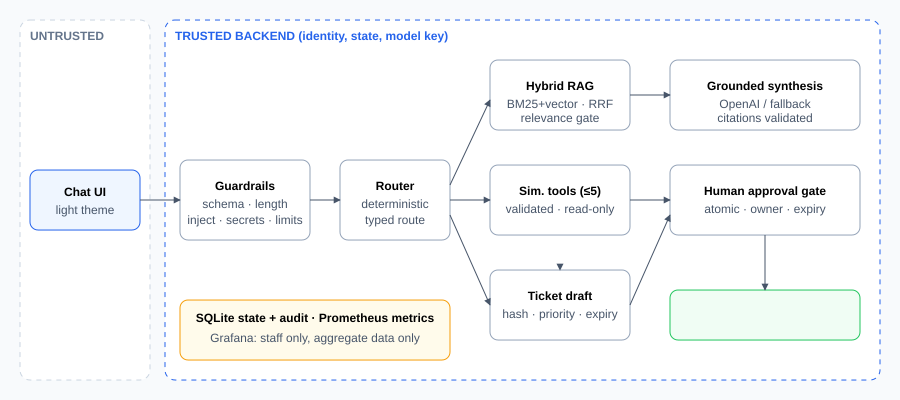
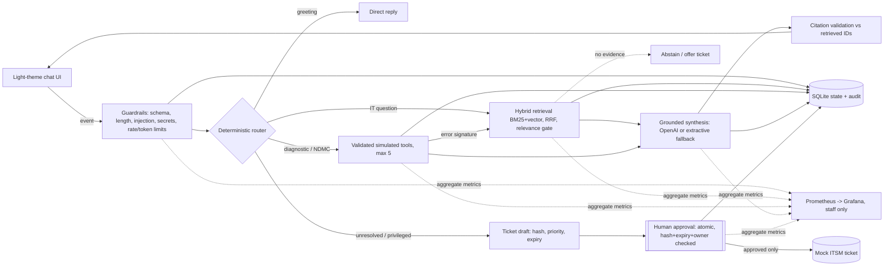

# Architecture (trust boundary + approval gate)

Trust boundary: the browser is untrusted; the Streamlit backend owns identity, state and the model key. Retrieved text and tool output are data, never instructions. Model output is never rendered as HTML (escaped; only validated citation labels become chips).
